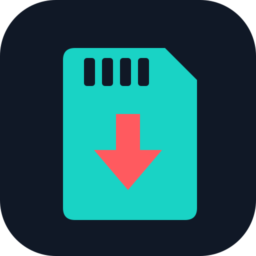

<p align="center"></p>

# UltraNX-NX

Atualizador do pacote **R O X** que roda **no próprio Nintendo Switch**. O
usuário só instala o `.nro` e abre: o app verifica a versão publicada, baixa e
confere o pacote, apaga o que o pacote substitui, extrai o novo e reinicia no
hekate.

> Em desenvolvimento — fase F0 (spike de plataforma). Veja [`docs/PLAN.md`](docs/PLAN.md).

## Como funciona

1. Lê `manifest.json` da release mais recente de
   [`mathst/rox-pack`](https://github.com/mathst/rox-pack) — endereço fixo no
   binário ([`include/ultranx/build_config.h`](include/ultranx/build_config.h)).
2. Baixa **todas** as partes para `sdmc:/ultranx-nx/staging/` e confere SHA-256.
   Nada é apagado antes disso.
3. Limpa o que o manifest manda (`cleanup`), sempre respeitando a proteção
   embutida: `Nintendo`, `emummc`, saves, `*.keys` e `JKSV` nunca são tocados.
4. Extrai as partes, grava `packetVersion.txt` e reinicia no hekate.

Queda de energia no meio? Ao reabrir, o app retoma de onde parou. Boot falhou?
O [UltraNX de PC](https://github.com/mathst/ultranx) recupera o cartão.

## Instalação

Copie `ultranx-nx.nro` para `sdmc:/switch/ultranx-nx/` e abra pelo Homebrew Menu.

## Build

Requer [devkitPro](https://devkitpro.org) (devkitA64 + libnx + `switch-curl`).
O CI compila no container `devkitpro/devkita64`.

```bash
make -C spike        # spike F0 atual
```

## Documentação

[`docs/PLAN.md`](docs/PLAN.md) · [`docs/specs/`](docs/specs/) — requisitos,
arquitetura, modelo de dados (manifest v2), API, UI, segurança, testes, deploy.

## Licenças

Código: ver `LICENSE`. [`third_party/miniz`](third_party/miniz) — MIT.
